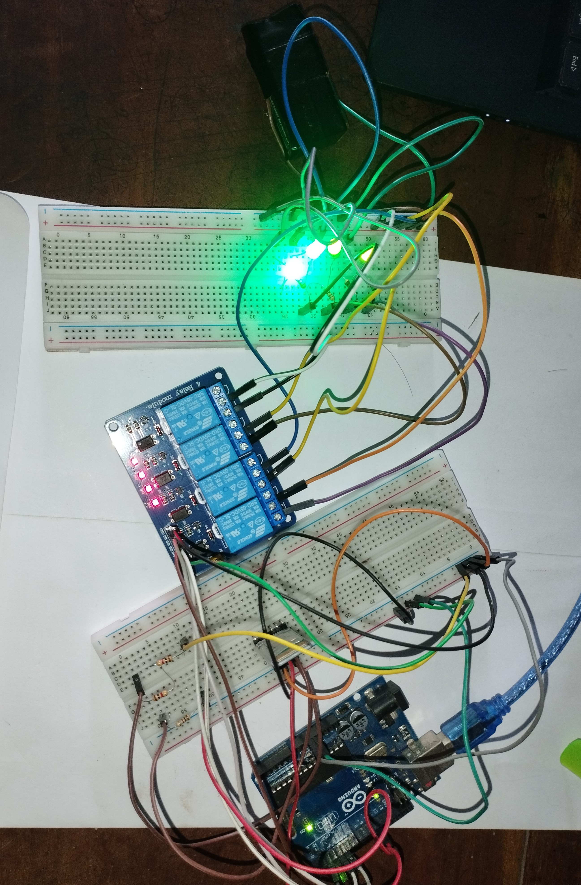
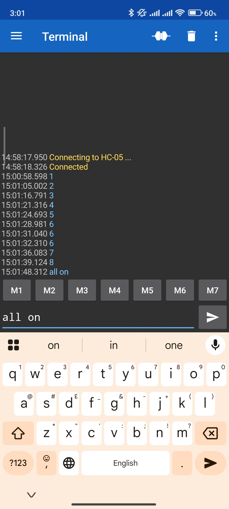

# Bluetooth and Voice-Controlled Home Automation using Arduino

An Arduino Uno home automation system that switches four loads (Light, Fan, TV and AC) through a 4-channel relay module. Commands arrive wirelessly from an Android phone over an HC-05 Bluetooth module, either spoken with the "BT Voice Control for Arduino" app or sent as text. A 16x2 LCD shows the name and the ON/OFF state of the load that was last switched.

Lab experiment (Experiment 06), Department of Electrical and Electronic Engineering, Rajshahi University of Engineering & Technology (RUET).



## How it works

1. The phone app converts a spoken phrase to text using the phone's speech recognition and sends it to the HC-05 as `*command#`, where `*` and `#` are the start and stop markers.
2. The HC-05 passes the text to the Arduino over UART (SoftwareSerial, 9600 baud).
3. The sketch removes the markers, converts the text to lower case and compares it with the known commands.
4. On a match, the matching relay is switched and the LCD shows the load name and its new state. The received text is also printed on the Serial Monitor.

The relay module is **active LOW**: the Arduino drives a pin LOW to switch a relay on and HIGH to switch it off. All relays are set to OFF at start-up.

## Voice commands

| Command | Action | Relay pin |
| --- | --- | --- |
| turn on light / turn off light | Light ON / OFF | D8 |
| turn on fan / turn off fan | Fan ON / OFF | D9 |
| turn on tv / turn off tv | TV ON / OFF | D10 |
| turn on ac / turn off ac | AC ON / OFF | D11 |

The text must match exactly (letter case is ignored). Any other text is ignored.

## Bluetooth terminal screenshot



The screenshot shows a Bluetooth serial terminal app on the phone connected to the HC-05, with the texts 1 to 8 and "all on" sent. The command table above lists the voice commands implemented in the sketch from the lab report. The texts in this screenshot are not part of that table.

## Hardware

| Part | Quantity | Notes |
| --- | --- | --- |
| Arduino Uno | 1 | ATmega328P, 5 V, 16 MHz |
| HC-05 Bluetooth module | 1 | UART, default 9600 baud, used as a slave in data mode |
| 4-channel relay module | 1 | 5 V coil, contacts rated 10 A at 250 VAC |
| 16x2 LCD | 1 | HD44780 controller, 4-bit mode |
| 10 kohm potentiometer | 1 | LCD contrast |
| Android smartphone | 1 | With the "BT Voice Control for Arduino" app |
| 5 V DC supply, USB cable | 1 each | Power and programming |
| Breadboard, resistors, jumper wires | | |

## Pin map

| Function | Arduino pin |
| --- | --- |
| HC-05 TX to Arduino RX (SoftwareSerial RX) | D2 |
| HC-05 RX from Arduino TX (SoftwareSerial TX) | D3 |
| Relay input 1 (Light) | D8 |
| Relay input 2 (Fan) | D9 |
| Relay input 3 (TV) | D10 |
| Relay input 4 (AC) | D11 |
| LCD RS | D7 |
| LCD EN | D6 |
| LCD D4, D5, D6, D7 | D5, D4, D12, D13 |

The HC-05 works with 3.3 V logic on its RX pin, so a voltage divider on the Arduino TX to HC-05 RX line is recommended.

## Build and run

1. Open `home-automation-using-arduino.ino` in the Arduino IDE and select the **Arduino Uno** board. The sketch uses the `SoftwareSerial` and `LiquidCrystal` libraries, which come with the Arduino IDE.
2. Wire the parts according to the pin map above.
3. **Disconnect the HC-05 TX and RX wires before uploading** the sketch, then reconnect them.
4. Power the circuit. The LCD shows "Home Automation System Ready".
5. Pair the phone with the HC-05 (default PIN 1234 or 0000), open the app, choose the HC-05 and connect.
6. Press the microphone button and say a command from the table above, for example "turn on light".

## Experiment results

As recorded in the lab report (`home-automation-report.pdf`), the system switched all four relay channels on and off correctly and the LCD showed the state of each load. The reported Bluetooth range was about 10 m in line of sight, with a delay of less than one second caused by speech recognition, and no false triggering was observed.

## Safety

The relay contacts are rated for mains voltage, but wiring a mains load is dangerous. Test the circuit with low-voltage loads such as LEDs first. Connect mains loads only with proper insulation and enclosure, and never touch the relay terminals while the load circuit is powered.

## Limitations

- Commands are matched as exact text, so the speech recognition must return the expected words.
- The phone gets no confirmation back. The ON/OFF state is shown only on the LCD and the Serial Monitor.
- There is no authentication beyond Bluetooth pairing. Anyone who can pair with the HC-05 can send commands, so change the default PIN for real use.
- Relays return to OFF whenever the Arduino resets.

## Repository contents

```
home-automation-using-arduino/
  home-automation-using-arduino.ino   Arduino sketch
  home-automation-report.pdf          Experiment report
  home-automation-exp-set-up.jpg      Photo of the experimental setup
  phn-input.jpg                       Screenshot of a Bluetooth serial terminal app
  README.md
```

## Author

Md. Raiyan Mahmud, EEE, RUET. Portfolio: https://raiyan2064.github.io
